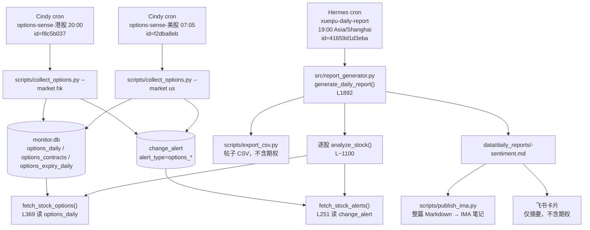

# 舆情日报「期权部分」梳理（只读调查）

> 调查日期：2026-11-09
> 范围：`~/code/claude_code/xueqiu-monitor`（舆情日报主体），跨仓线索已核到 `~/pdd-options` 与 Hermes/Cindy 调度。
> 性质：**只读**。本次未改任何代码、配置、cron、数据；未 commit。
> 结论先行：日报里**已经没有独立的「期权章节」**（2026-10-15 起并入逐股分析）。现在说的「期权部分」是散在正文里的四层内容，删除时必须一层层处理，否则会删一半、留一半。

---

## 0. 一句话结论

「舆情日报」由 **Hermes cron `xueqiu-daily-report`（每天 19:00 北京时间）** 调 `src/report_generator.py` 生成，输出 `data/daily_reports/YYYY-MM-DD-sentiment.md`，再发 IMA 笔记 + 飞书卡片。期权内容不是独立段落，而是**逐股 prompt 素材 + 0 帖占位行 + 尾注 + 期权告警**四层；数据来自 monitor.db 的三张期权表，由 **Cindy 两个独立调度（07:05 美股 / 20:00 港股）** 采集。**PDD 期权日报是另一个完全独立的任务，不在删除范围内。**

---

## 1. 舆情日报是谁生成的

### 1.1 调用链

### 1.2 逐项证据

| 环节 | 证据（路径:行号） | 说明 |
|---|---|---|
| 日报调度 | Hermes `~/.hermes/cron/jobs.json` 中 `xueqiu-daily-report`（id `41659d1d3eba`，cron `0 19 * * *`，TZ 北京） | 19:00 生成 + IMA + CSV + 飞书卡片 |
| 日报入口 | `src/report_generator.py:1892` `generate_daily_report()` | 产出 Markdown 并落盘 |
| 输出 | `src/report_generator.py:2119` `output_path = output_dir / f"{date_str}-sentiment.md"` | 实际路径 `data/daily_reports/` |
| IMA 发布 | `scripts/publish_ima.py:239` `content = report_path.read_text(...)`；`:193-194` 以 markdown 整篇导入 | **整篇报告（含期权文字）都会进 IMA 笔记** |
| 飞书卡片 | Hermes 任务 prompt 第 4 步 | 卡片只写字数/股票数/温度计摘要，**不含期权内容** |
| CSV 导出 | `scripts/export_csv.py`（全文无 option/期权 引用） | 只有帖子与公告，不含期权 |
| 采集调度 | Cindy scheduler `options-sense·美股期权日频采集`（`f2dba8eb`，`5 7 * * *`）、`options-sense·港股期权日频采集`（`f8c5b037`，`0 20 * * *`） | 两者都是 script 模式，零 token |
| 采集入口 | `scripts/collect_options.py:179` `main()`；`:89` `_run_us()`；`:117` `_run_hk()` | `--market us/hk` |
| 采集实现 | `src/options_collector.py:426` `collect_options()`；`src/options_hk.py:523` `collect_hk()` | CBOE / Longbridge / HKEX DTOP |
| 信号 | `src/options_detector.py:44` `detect_options_signals()` | 写 `change_alert`（`options_volume_spike` 等） |
| 报告里的期权融入 | `src/report_generator.py:1115` `options = fetch_stock_options(...)`；`:1235` `options=options` 传给 prompt | 逐股喂给 LLM |

### 1.3 两个容易混淆的「期权日报」

| 名称 | 归属 | 调度 | 数据 | 是否本次范围 |
|---|---|---|---|---|
| 舆情日报里的期权内容 | xueqiu-monitor | Hermes 19:00 报告 + Cindy 07:05/20:00 采集 | `data/monitor.db` 期权三表 | ✅ 本次对象 |
| **PDD期权·20倍组合日报** | 独立脚本 `~/pdd-options/daily_matrix.py` | Cindy `49b8148a`，`0 0 * * 2-6` | 直接拉 CBOE，**不读 monitor.db** | ❌ **明确不动** |

证据：`~/pdd-options/daily_matrix.py:18` 自建 `CBOE_URL`；全文无 `xueqiu` / `monitor.db` / `options_daily` 引用；`plans/options-sense/PLAN.md:93` 也写明「两层互不干扰」。

---

## 2. 期权内容从哪来（四层，缺一层都删不干净）

> 关键历史：2026-10-15 `1ce8228 feat(report): 期权数据融合进每只个股的分析 (#85)` 删掉了独立的「期权温度计」章节，改为逐股注入。所以现在日报里**没有「## 期权数据」这种标题**，只有正文里的期权句子。

以 2026-11-09 日报实测：全文 `grep -c "期权"` = **84 行**。

| 层 | 位置（路径:行号） | 产生什么 | 用户在哪能看到 |
|---|---|---|---|
| **① prompt 素材块** | `src/report_generator.py:734-743` `_format_options_block()`；`:959-970` 注入 prompt 的 `## 期权数据` 段 | 把期权读数 + 解读指南塞进每只股票的 LLM prompt | 不直接可见，但**决定了正文里所有期权句子** |
| **①a 解读指南（“介绍”本体）** | `src/report_generator.py:646-659` `_OPTIONS_GUIDE` | 8 条期权语义约束（IV/PCR/墙/Max Pain 怎么读、不许推断方向） | 不可见（只在 prompt 里） |
| **①b 口径说明** | `src/report_generator.py:660-665` `_OPTIONS_CALIBER` | cboe / hkex / longbridge 三源口径 | 会被模型转述成「期权口径：…」 |
| **①c 读数渲染** | `src/report_generator.py:667-733` `_options_readings()` | 近端/月度期限桶、ATM IV、PCR、墙、Max Pain、备兑收益率 | 模型转述成正文长段 |
| **①d 输出要求** | `src/report_generator.py:985-988` `_OPTIONS_ASK_DEEP/_STD`，在 `:1009/:1020/:1044` 注入各档位指令 | 强制模型「若素材里有期权段，必须在情感读数/判断里写」 | 决定了「期权口径」句子必然出现 |
| **② 0 帖占位行** | `src/report_generator.py:1177-1183` | 当天无帖的股票也写一行 `- 期权读数（日期，口径）: ...` | ✅ 直接可见（平稳股/无帖股） |
| **③ 尾注「无上市期权」** | `src/report_generator.py:1715-1737` `_hk_codes_with_options()`；`:1739-1761` `_hk_no_option_note()`；`:2005-2010` 生成；`:2082-2083` 进尾注 | 「自选港股中 8 只无上市期权：…」 | ✅ 直接可见（2026-11-09 报告第 1682 行） |
| **④ 期权告警** | `src/options_detector.py:44` 写 `change_alert`；`src/report_generator.py:251-276` `fetch_stock_alerts()`（逐股「今日异常信号」）、`:1505-1526` `fetch_day_alerts()`（「今日要点」候选）、`:279-292` `_ALERT_LABELS` 期权标签 | `options_volume_spike` / 历史 `options_pcr_spike` 等 | ✅ 可能出现在「今日要点」「今日异常信号」 |

**注意**：`fetch_stock_alerts` / `fetch_day_alerts` 的 SQL **没有排除** `options_*` 类型（只排除了 `new_announcement`）。只删 prompt 素材块而不改这两条 SQL，期权告警仍会以「期权成交量激增」等形式留在日报里。

---

## 3. 谁在消费这份报告

| 消费方 | 读取方式 | 是否单独抽取期权 | 证据 |
|---|---|---|---|
| IMA 笔记 | `scripts/publish_ima.py` 整篇 Markdown 导入 | 否（整篇原样） | `publish_ima.py:193-194, 234-240` |
| 飞书卡片 | Hermes 19:00 任务 prompt 第 4 步 | 否（只发摘要） | `xueqiu-daily-report` prompt |
| 本地日报 md | 人工 / 巡检脚本 | 巡检只看文件是否存在 | `xueqiu-crawler/scripts/schedule-checks/check.mjs:252-261` |
| CSV 知识库 | `scripts/export_csv.py` | 否 | 全文无 option 引用 |
| `xueqiu-crawler` 仓 | 只做「文件存在性」检查 | 否 | `check.mjs` 同上 |
| `morning-brief` 仓 | **不读**本日报 | 否 | 全仓 grep 无 `sentiment.md` / `options_daily` 消费 |
| 看板 / 告警 | `scripts/health_check.py`、`cron_healthgate.sh` | **不看期权** | 两者全文无 option/期权 |
| Git log / PROJECT_LOG | 历史记录 | 否 | `PROJECT_LOG.md:124-127` 仅溯源 |

**结论：没有任何脚本单独抽取、统计或入库日报里的期权文字。** 期权数据只回流到「下一轮 prompt」，以及 IMA 笔记供人/AI 检索。

---

## 4. 删除的影响面

### 4.1 代码与模板

| 文件 | 关键行 | 作用 | 删除影响 |
|---|---|---|---|
| `src/report_generator.py` | 366-434 `fetch_stock_options` | 取期权读数 + 5 天新鲜度闸 | 只服务日报 |
| 同上 | 646-665 | `_OPTIONS_GUIDE` / `_OPTIONS_CALIBER` | 只服务日报 prompt |
| 同上 | 667-743 | 读数渲染 | 只服务日报 |
| 同上 | 959-970 | prompt 注入 | 只服务日报 |
| 同上 | 985-988, 1009/1020/1044 | 输出要求 | 只服务日报 |
| 同上 | 1115, 1235 | 取数并传 prompt | 只服务日报 |
| 同上 | 1177-1183 | 0 帖占位 | 只服务日报 |
| 同上 | 1715-1761, 2005-2010, 2082-2083 | 港股无期权尾注 | 只服务日报 |
| 同上 | 251-276, 1505-1526, 279-292 | 期权告警入 prompt / 标签 | 若保留采集，需排除 `options_*` |
| `src/options_collector.py` | 全文 453 行 | 美股 CBOE + Longbridge 回填/交叉校验 | 除采集脚本外无其他调用方 |
| `src/options_hk.py` | 全文 586 行 | 港股 HKEX DTOP + 类代码表 | 同上；`report_generator` 只 import `class_cache_path/load_class_cache` 用于尾注 |
| `src/options_detector.py` | 全文 106 行 | L1 信号 | 只被 `collect_options.py` 调用 |
| `scripts/collect_options.py` | 全文 211 行 | 两个 cron 的入口 | 两个 Cindy 调度唯一入口 |
| `scripts/backfill_option_annotations.py` | 全文 | 一次性回填 `chain_expiry` / `premium_yield` | 已跑完，可归档 |
| `src/config.py` | 86-93 | `options` 配置块（enabled / us_symbols / cross_tolerance...） | 仅采集使用 |
| `src/db.py` | 128-144, 1035-1170 | 迁移 + 期权读写函数 | 仅期权链路使用 |
| `src/schema.sql` | 245-341 | 三张表 + 索引 | 仅期权链路使用 |
| `src/models.py` | 115-140 | `OptionDaily` 数据类 | 仅期权链路使用 |

### 4.2 存储

| 对象 | 现状 | 备注 |
|---|---|---|
| `options_daily` | 1,317 行 | 一股一日一行（多源） |
| `options_contracts` | **892,731 行**，约 **121 MB** + 索引约 **58 MB** | 约 4.2 万行/天，日增约 6–10 MB |
| `options_expiry_daily` | 3,932 行 | 期限桶 |
| `data/hk_option_classes.json` | 港股类代码表缓存 | 采集与尾注共用 |
| `data/monitor.db` 总体积 | 619 MB | 期权三表 + 索引约占 **180 MB（~29%）** |

**没有任何清理任务会回收期权表**：`~/.hermes/scripts/weekly_data_cleanup.sh` 只清日报 md / 日志，不碰 DB 表。长期保留会持续增长（一年约 2–3 GB 量级）。

### 4.3 调度

| 调度 | 位置 | 现状 |
|---|---|---|
| `options-sense·美股期权日频采集` | Cindy `f2dba8eb`，`5 7 * * *` | 最近 5 次均 success |
| `options-sense·港股期权日频采集` | Cindy `f8c5b037`，`0 20 * * *` | 最近一次（2026-11-09 20:00）**failed**（urllib 网络异常），此前 4 次 success |

**这两个调度只服务日报期权段**，停掉不影响舆情 pipeline（Hermes `xueqiu-pipeline` / g1–g5 完全不含期权调用：`src/cli.py` 全文无 option 引用）。

### 4.4 测试与文档

| 对象 | 说明 |
|---|---|
| `tests/test_options_fusion.py`（~360 行） | **直接断言日报里必须有期权块/占位/尾注**，方案 A 必须改或删 |
| `tests/test_options_sense.py` | 采集 + 信号单测 |
| `tests/test_options_hk.py` | 港股采集单测 |
| `tests/test_collect_options_protocol.py` | cindy-script/1 协议帧单测 |
| `plans/options-sense/PLAN.md` | 设计文档（历史） |
| `plans/options-sense/期权链分析升级方案-2026-10-23.md` | 审计/设计文档（历史） |
| `PROJECT_LOG.md:124-127` | F-020～F-023 功能台账（**历史记录，不建议改写**） |
| CI | `.github/workflows/tests.yml` 跑全量 pytest；删测试文件后 CI 自然收敛 |

### 4.5 明确「零影响」的面

- 舆情抓取、情感分析、热词、公告、资讯详情、温度计、今日要点（除期权告警外）、主线：均不依赖期权。
- 飞书卡片、CSV 导出、IMA 发布脚本：均不解析期权。
- PDD 期权日报：独立脚本，不读本库。

---

## 5. 三个删除方案

> 工作量按「改代码 + 改测试 + 过质量门禁 + 人工核对一份日报」估算，不含主人决策等待时间。

### 方案 A：只隐藏日报里的期权内容（保留采集与数据）

**改什么**

| 文件 | 改动 |
|---|---|
| `src/report_generator.py` | 删除 `options = fetch_stock_options(...)`（1115）与 `options=options`（1235）；删除 `_format_options_block` 注入（959-970）；删除 `_OPTIONS_ASK_*` 及其注入（985-988 / 1009 / 1020 / 1044）；删除 0 帖占位 `opt_line`（1177-1183）；删除 `hk_gap_note` 调用与尾注（2005-2010 / 2082-2083）；删除 `_OPTIONS_GUIDE` / `_OPTIONS_CALIBER` / `_options_readings` / `_format_options_block` / `fetch_stock_options` / `_hk_codes_with_options` / `_hk_no_option_note`；删除期权 `_ALERT_LABELS`（284-292） |
| 同上 | 若要「完全不提期权」，在 `fetch_stock_alerts`（261）与 `fetch_day_alerts`（1512）加 `AND alert_type NOT LIKE 'options_%'` |
| `tests/test_options_fusion.py` | 删除/改写为「日报不含期权」的断言（该文件几乎全部用例都为此而设） |
| 其它 | 采集、DB、cron、config 全部不动 |

**风险**
- 采集继续跑，数据继续涨（约 10 MB/天），但日报不再使用 —— 有成本无收益。
- 若只删 prompt 不改两条告警 SQL，期权告警仍会出现在「今日要点 / 今日异常信号」，属于删不干净。
- `OPTIONS_MAX_AGE_DAYS` 与新鲜度闸逻辑一起变成死代码，须一并删，避免 lint 报未使用。

**可回滚**：`git revert` 单个 commit 即可；数据从未停止采集，回滚后立即可用。
**验证**
1. 用临时配置把 `report_output_dir` 指到 `/tmp/...`，跑一次 `generate_daily_report(date_str=<最近有数据日>)`；
2. `grep -c "期权" <输出>.md` 应为 0；
3. `pytest tests/test_options_fusion.py`（改写后）与其他单测全绿；
4. 确认「今日要点」不再出现 `options_*` 告警。
**工作量**：约 **0.5 天**（含测试改写与门禁）。

---

### 方案 B：A + 停掉只服务该段的采集/入库

**改什么**

| 对象 | 改动 |
|---|---|
| Cindy `f2dba8eb`（美股 07:05） | `schedule_pause` |
| Cindy `f8c5b037`（港股 20:00） | `schedule_pause` |
| （可选）`etc/config.json` 或 `src/config.py` | `options.enabled = false`，作为二道保险 |
| 代码 | 同方案 A |

**风险**
- 期权历史数据**冻结**。若以后恢复：CBOE 只给当日快照、无历史回补；Longbridge 只能回填 20 天；HKEX DTOP 可回补近 7 天。**断档期无法补齐**。
- `change_alert` 里不再产生新 `options_*`，若 A 已过滤告警则无感。
- 两个调度停掉后，`health_check` / `cron_healthgate` 不会报警（它们本就不检查期权）。
- 港股 20:00 那次目前偶发网络失败，停掉反而少一条噪声。

**可回滚**：`schedule_resume` 两个调度 + 恢复 `options.enabled=true`；代码同 A 的 revert。
**验证**
1. `schedule_list` 确认两条 status=paused；
2. 次日检查 `options_daily` 无新增 `stat_date`；
3. 日报 `grep "期权"` = 0；
4. 跑 `python3 scripts/collect_options.py --dry-run` 确认即使手工触发也不落库（`enabled=false` 时直接跳过）。
**工作量**：约 **0.5–0.75 天**（A 的工作量 + 调度操作与次日复核）。

---

### 方案 C：彻底移除采集、存储、模板、cron、文档

**改什么**

| 类别 | 动作 |
|---|---|
| 代码 | 删除 `src/options_collector.py`、`src/options_hk.py`、`src/options_detector.py`、`scripts/collect_options.py`、`scripts/backfill_option_annotations.py` |
| 报告 | 同方案 A 的全部删除 |
| 数据层 | 删除 `src/schema.sql:245-341` 三表；删除 `src/db.py:128-144, 1035-1170`；删除 `src/models.py:115-140`；删除 `src/config.py:86-93` |
| 数据文件 | 删除 `data/hk_option_classes.json` |
| 数据库 | `DROP TABLE options_daily/options_contracts/options_expiry_daily` + `VACUUM`（回收约 180 MB） |
| 调度 | `schedule_delete` 两个 Cindy 调度 |
| 测试 | 删除 4 个 `test_options_*.py` / `test_collect_options_protocol.py` |
| 文档 | 归档/删除 `plans/options-sense/`；`PROJECT_LOG.md` 只追加「已下线」一行，不改历史 F-020～F-023 |

**风险**
- **不可逆**：代码可 `git` 找回，但历史期权数据一旦 `DROP + VACUUM` 只能靠 DB 备份恢复（每日 05:30 备份 cron `8925a4006b22`，保留策略需先确认）。
- 若未来要重做，等于从零重建（CBOE 逐合约、HKEX DTOP、Longbridge 回填、口径闸、测试，历史工作量约 1 个月）。
- schema 变更需要迁移脚本；老库直接跑新代码会因缺表报错，须先做 `init_db` 兼容处理。
- 删除 `options_hk` 会连带删掉港股类代码表缓存逻辑，若未来别的功能想用 HKEX 映射需重写。

**可回滚**：只能「代码 git revert + 从备份恢复 DB」，且只能回到备份时点；**当天数据会丢**。
**验证**
1. `grep -ri "option\|期权" src/ scripts/ tests/ etc/` 只剩历史文档命中；
2. `pytest` 全绿；
3. `sqlite3 data/monitor.db ".tables"` 无 options 三表；
4. `schedule_list` 无 `options-sense` 两项；
5. 生成一份日报，`grep "期权"` = 0。
**工作量**：约 **2–3 天**（含 DB 迁移、备份核对、全量回归），另有数据删除的不可逆风险。

---

### 方案对比与推荐

| 维度 | A 隐藏 | B 隐藏 + 停采集 | C 彻底移除 |
|---|---|---|---|
| 改动文件 | 1 + 测试 | 1 + 测试 + 2 调度 | ~10 + 测试 + 文档 + DB |
| 风险 | 低 | 低–中（历史断档） | 高（不可逆） |
| 可回滚 | 极易 | 易 | 难（依赖备份） |
| 验证难度 | 低 | 低 | 中–高 |
| 停止 DB 增长 | ❌ | ✅ | ✅ 且回收 180 MB |
| 工作量 | 0.5 天 | 0.5–0.75 天 | 2–3 天 |

**推荐：先做 A，并同时拍板是否接着做 B。**
理由：
1. 主人当前诉求是「日报里删掉期权部分」，A 就完全满足，且可当天上线、随时回滚；
2. 若确认「以后不看期权」，B 的增量成本极小（只多两次 `schedule_pause`），还能止住每天约 10 MB 的库增长；
3. C 的收益（回收 180 MB）与风险（不可逆、2–3 天）不匹配，除非主人明确要求「连代码和数据一起清掉」；
4. 无论选哪个，都要顺带处理**期权告警**这条暗线，否则会残留。

---

## 6. 明确不该动的

| 对象 | 原因 |
|---|---|
| **PDD期权·20倍组合日报**（Cindy `49b8148a`，`~/pdd-options/daily_matrix.py`） | 独立任务，直连 CBOE，不读 monitor.db，与本次删除无关 |
| Hermes `xueqiu-pipeline` / `g1`–`g5` | 只做抓取/情感/告警，不含期权 |
| `xueqiu-daily-report` 的 IMA / CSV / 飞书卡片步骤 | 删除期权不改变这三步的结构 |
| `PROJECT_LOG.md` 历史功能台账（F-020～F-023） | 历史记录，只追加不改写 |
| `data/monitor.db` 里的非期权表 | 与期权无关 |

---

## 7. 需要主人确认的问题

1. **「期权部分」具体指哪几层？**
   - (a) 全部：逐股正文里的期权句子 + 0 帖占位「期权读数」+ 尾注「无上市期权」+ 期权告警；
   - (b) 只删「介绍/解读指南」性质的文字，保留数字读数；
   - (c) 只删尾注和 0 帖占位这类「介绍性」行，保留逐股分析里的期权判断。
   - 备注：`_OPTIONS_GUIDE`（646-659）是 prompt 里的「介绍」，用户看不到；用户看到的「期权口径：…」是模型转述。若主人指的是「那句长长的期权口径说明」，方案会不一样。
2. **是否保留采集与数据？** 保留 → A；不保留 → B；连数据一起删 → C。
3. **期权告警（`change_alert` 的 `options_*`）是否也从「今日要点 / 今日异常信号」移除？** 建议移除，否则删不干净。
4. **确认 PDD 期权日报不在范围内。**
5. 若选 B/C，是否授权停/删两个 Cindy 调度（`f2dba8eb`、`f8c5b037`）？

---

## 8. 未确认 / 需注意

- **未确认**：主人说的「舆情日报」是在哪个界面看到的（IMA 笔记？本地 md？飞书卡片？）。飞书卡片本来就不含期权；若主人只看卡片，那可能不是这段内容的问题。建议先确认看到的原文截图或所在位置。
- **未确认**：主人是否把「期权段」理解为 2026-10-15 之前那个独立章节。该章节已经不存在（commit `1ce8228`）。
- 港股采集 2026-11-09 20:00 那次失败是网络异常（urllib traceback），不是期权逻辑问题；若选 B 停采集则自动消失。
- 期权告警在 2026-10-28 之后没有新增（当前 `options_detector` 只发 `volume_spike`，PCR 告警逻辑已注释）；DB 里 10-21～10-28 的 `options_pcr_spike` 是旧版本产物。

---

## 9. 十行摘要（便于转述）

1. 舆情日报由 Hermes `xueqiu-daily-report` 每天 19:00 生成，输出 `data/daily_reports/*-sentiment.md`，同步发 IMA 笔记与飞书卡片。
2. 日报里**没有独立的期权章节**，2026-10-15 起已并入逐股分析；2026-11-09 报告全文出现「期权」84 行。
3. 期权内容分四层：逐股 prompt 素材块、0 帖占位「期权读数」行、尾注「港股无上市期权」、期权告警。
4. 数据来自 monitor.db 三张表，由 Cindy 两个调度采集：美股 07:05（`f2dba8eb`）、港股 20:00（`f8c5b037`）。
5. 没有任何脚本单独抽取或统计日报里的期权文字；IMA 只是整篇转存，飞书卡片和 CSV 都不含期权。
6. 期权三表约占 619 MB 库的 180 MB，合约表每天新增约 4.2 万行（~10 MB），且没有清理任务。
7. 方案 A（只隐藏日报内容，保留采集）= 0.5 天、可随时回滚，推荐先做。
8. 方案 B（A + 停两个采集调度）= 0.5–0.75 天，能止住库增长；代价是历史数据断档、后续无法回补。
9. 方案 C（彻底删代码/表/cron/文档）= 2–3 天、不可逆，只有主人明确要求才做。
10. **PDD期权·20倍组合日报是独立任务，不在删除范围**；需要主人确认「期权部分」具体指哪几层、是否保留采集。
